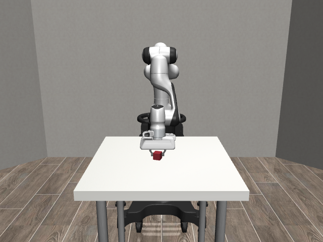

<div align="center">

# AdaptiveGrasp-v0 · Gymnasium Environment

**Panda + MuJoCo + robosuite environment for adaptive reward shaping**

*ME5418 Group 36 · Environment Implementation Milestone*

[← Back to main project](../README.md)



[Scripted grasp video](results/scripted_demo.mp4) · [Random policy video](results/random_demo.mp4) · [Report (PDF)](report.pdf) · [Validation](VALIDATION.md)

</div>

> **English summary.** `AdaptiveGrasp-v0` wraps the robosuite Panda Lift task as a Gymnasium environment with three reward modes (sparse, fixed, adaptive), an episode-level Reach→Grasp→Lift scheduler, a component replay buffer for SAC, random and scripted demos, and automated tests. The scripted demo is a hand-written controller, not a trained policy, and the bundled short SAC model is a pipeline smoke test only. Detailed documentation below is in Chinese.

---

基于 Panda + MuJoCo + robosuite 的自定义 Gymnasium 环境。交付包括随机策略与脚本抓取演示、三种奖励、Episode Scheduler、接口/物理测试、可选 SAC 和两页英文报告。本项目是环境实现；脚本演示不是训练出来的策略，附带的短程 SAC 模型也没有学会抓取。

## 1. 快速运行

在已激活 `grasp_rl` 环境（见第 2 节）的终端中，进入本目录：

```text
cd GraspRL
python demo.py --policy scripted --horizon 300 --realtime
```

Windows 下也可以双击 `run_scripted_demo.cmd`。MuJoCo 窗口会展示机器人接近、抓住并抬起方块，Episode 成功后关闭；不需要先训练。随机策略演示可双击 `run_random_demo.cmd`，它通常不会抓取成功。

直接查看录像：[`results/scripted_demo.mp4`](results/scripted_demo.mp4)、[`results/random_demo.mp4`](results/random_demo.mp4)。

## 2. 新电脑 / 新 Conda 环境安装

在 **Anaconda Prompt** 或已经初始化 Conda 的 PowerShell 中，进入解压后的 GraspRL 目录：

```text
conda env create -f environment.yml
conda activate grasp_rl
python -c "import mujoco, robosuite, gymnasium, stable_baselines3; print('All imports successful')"
python -m pytest -q
python demo.py --policy random --realtime
python demo.py --policy scripted --horizon 300 --realtime
```

`environment.yml` 使用 Python 3.10 和完整的 `requirements-lock.txt`。另附 `environment-win64.yml`，是本机 Conda 导出的无绝对路径配置。新环境复现验证记录见 `results/reproduction_*.log`。已实测平台是 Windows x64；Linux/macOS 的图形后端和软件包可用性未实测。安装需要联网；ZIP 不含 Conda、Python 或第三方模型资源，robosuite 安装包会提供 Panda 资源。

主版本：robosuite 1.5.2、MuJoCo 3.3.7、Gymnasium 1.2.1、SB3 2.7.0、NumPy 1.26.4。**不要单独升级 MuJoCo**：首次安装的新版本曾因 `MjData.qM` 接口变化导致 OSC 控制器启动失败。完整实际版本和观测布局见 `results/environment_manifest.json`。

初次导入可能提示缺少私有 macros、robosuite_models 或 GR1 的 mink IK。这些是上游可选功能警告；Panda + OSC 路径不需要它们。Gymnasium 对无限观测边界也会给出两条警告；实际观测值经过有限性和空间检查。

## 3. 常用命令

以下命令在激活环境后，从本项目目录运行：

```text
python demo.py --policy random --mode sparse --render none
python demo.py --policy scripted --mode fixed --horizon 300 --realtime
python demo.py --policy random --mode adaptive --episodes 30 --render none
python demo.py --policy scripted --mode adaptive --episodes 30 --horizon 300 --render none
python demo.py --policy scripted --horizon 300 --render rgb_array --video results/my_demo.mp4
python -m pytest -q --junitxml=results/tests.xml
```

默认 `--render human` 使用原生 MuJoCo 窗口，`rgb_array` 用于录像，`none` 用于无图形运行。截图、视频、JSON 日志均由实际仿真生成。`--seed` 控制每个 Episode 的物体放置，连续 Episode 采用 seed、seed+1 等。关闭可视化不改变奖励定义。

Python API：

```python
import gymnasium as gym
import grasp_env  # registers AdaptiveGrasp-v0

env = gym.make('AdaptiveGrasp-v0', reward_mode='fixed')
obs, info = env.reset(seed=42)
obs, reward, terminated, truncated, info = env.step(env.action_space.sample())
env.close()
```

## 4. 环境与奖励定义

- 机器人：Panda 七自由度机械臂、平行夹爪；robosuite Lift 场景。
- 动作：7 维 float32，全部限制在 [-1, 1]。前 3 维为世界坐标系位置增量，接着 3 维为旋转增量，最后 1 维控制夹爪（正值闭合）。OSC_POSE 的位置输出最大 0.05 m、旋转输出最大 0.5 rad；物理积分步长 0.002 s，控制频率 20 Hz。
- 观测：60 维 float32，由 50 维 `robot0_proprio-state` 和 10 维 `object-state` 拼接。机器人部分含关节状态、末端状态、夹爪状态；物体部分含位置、四元数和夹爪到方块的相对位置。具体字段以 manifest 为准，不含图像。
- 随机性：模型构建 seed 固定为 0，保证跨环境方块尺寸一致；Episode 的 seed 控制方块位置与角度。初始化关节噪声关闭；方块位置在 robosuite 默认桌面范围随机化。`hard_reset=False` 避免每集重新生成模型。
- Reach：`r_reach = 1 - tanh(5 * distance)`。Episode 中距离达到 0.05 m 内即记录 Reach 成功。
- Grasp：调用 robosuite `_check_grasp`，要求左右指接触组分别接触 cube 的碰撞几何体。仅闭合夹爪不算。它是双侧接触代理条件，不是严格的力闭合或长期稳定性证明。
- Lift：进度为 `clip((cube_z - reset_cube_z) / 0.04, 0, 1)`；成功时设为 1。最终成功必须使用 `_check_success()`，在锁定版本中为 **方块中心 z > 桌面 z + 0.04 m**。本场景桌面 z=0.8 m，因此成功阈值是中心 z>0.84 m；不是“相对初始位置再升高 4 cm”。
- Sparse：成功时 reward=1，其余为 0。Fixed：三个分量加权，权重 (0.3, 0.3, 0.4)。Adaptive：同样的分量，使用 Scheduler 权重。
- 成功：`terminated=True`。未成功且到达 horizon：`truncated=True`；默认 horizon=200。成功恰逢 horizon 时以成功结束。两者不会同时为 True。结束后必须 reset，不能继续 step。

所有常数均为本环境里明确固定的初始设计值，未通过大规模调参验证优劣。脚本演示只使用位置伺服与夹爪命令，没有移动方块或伪造接触；仅物理成功单元测试会人为设置方块位置，以隔离测试成功和终止判据。

## 5. Scheduler 与 Replay

Scheduler 保存最近 N=20 个**完成的** Episode 中是否曾 Reach/Grasp/Lift。每 K=5 个完成 Episode 尝试更新；窗口不足 20 集时不更新。Reach 成功率 >=0.8 时进入 Grasp 阶段；Reach>=0.8 且 Grasp>=0.6 时进入 Lift 阶段。候选阶段必须连续两次更新都一致才切换，也允许连续失败后退回早期阶段。

三个阶段权重依次为 (0.6,0.3,0.1)、(0.2,0.6,0.2)、(0.1,0.2,0.7)。权重在一个 Episode 内固定，更新值在下一次 reset 生效。Lift 成功率会被记录，但不作为切换门槛。手动中途 reset 的未完成 Episode 不会计入 Scheduler。普通 reset 保留 Scheduler；`reset(options={'reset_scheduler': True})` 开始全新课程。

Adaptive SAC 默认使用 `ComponentReplayBuffer`，保存每步三个奖励分量，并按当前权重在采样时重新计算 reward，保留时间截断的 bootstrap 语义。此实现支持单环境、一步 SAC，不支持并行 VecEnv / n-step / VecNormalize 的组合。`--historical-rewards` 可以显式使用历史标量奖励作为对照，其非平稳问题需要在实验中说明。

## 6. 可选 SAC 训练与评估

```text
python train.py --mode adaptive --steps 256 --learning-starts 32 --buffer-size 1000 --output results/my_smoke
python train.py --mode sparse --steps 100000 --seed 0 --output results/sparse_seed0
python train.py --mode fixed --steps 100000 --seed 0 --output results/fixed_seed0
python train.py --mode adaptive --steps 100000 --seed 0 --output results/adaptive_seed0
python evaluate.py results/adaptive_seed0/sac_model.zip --episodes 20 --seed 1000
```

训练使用 CPU、小型 MLP、默认回放容量 100,000，以控制资源占用。交付的 `results/sac_smoke` 仅执行 256 步和 224 次梯度更新；不能把这个模型当作训练完成的抓取模型。评估使用共同 Sparse 成功判据、确定性动作和独立评估 seeds，不更新 Scheduler。正式比较应采用相同预算、相同设置和多随机种子，比较成功率，而不是比较不同奖励尺度下的原始 return。当前未完成这种研究实验，也没有宣称 Adaptive 优于 Fixed。

## 7. 文件与验证证据

| 文件 | 用途 |
|---|---|
| `grasp_env.py` | Gymnasium 封装、动作/观测、终止与可视化 |
| `reward_functions.py` | 三个奖励分量与模式组合 |
| `adaptive_scheduler.py` | 滑动窗口、周期更新、连续确认 |
| `demo.py` | 随机/脚本策略、录像、截图、内存与轨迹日志 |
| `replay_buffer.py`, `train.py`, `evaluate.py` | 可选 SAC 与奖励重新计算 |
| `test_environment.py`, `test_replay_buffer.py` | 接口、奖励、物理、种子、Scheduler、Replay 验证 |
| `report.pdf` | 两页英文实现与反思报告 |
| `tools/build_report.py` | 报告源文件，重新生成需额外安装 reportlab、pypdf |
| `results/` | 实测日志、机器可读结果、录像、截图及短程模型 |
| `environment.yml`, `requirements-lock.txt` | 新环境安装入口与锁定版本 |
| `environment-win64.yml` | 本机实际 Conda 导出配置 |
| `tools/package_submission.py` | 打包源码和证据，排除虚拟环境与缓存 |

自动化验证覆盖：两套接口检查；三种奖励与超时；相同 seed reset；跨环境尺寸一致；远离方块时闭合夹爪不会误判；直接设置高处方块触发真实成功判据；脚本通过实际接触完成抓取抬起；Scheduler 升级/退级；Replay 用新权重重算且正确处理超时。

内存：本机系统总 RAM 23.81 GiB；单环境离屏录像在实际日志中约 650–660 MiB RSS（不同运行有波动，不含操作系统及其他程序）。正式训练、加大回放或并行进程需要额外内存。ZIP 不含 `.conda` 等本地环境目录。

## 8. 局限与 AI 使用说明

环境复用 MuJoCo 的动力学、robosuite 的机器人模型、控制器与 Lift 基础场景。自定义工作是接口适配、奖励、阶段跟踪、课程调度、Replay 处理、测试与日志。接触条件是抓取代理指标，任务没有加入视觉、遮挡、真实机器人迁移或全面的安全约束。自适应权重没有进入观测，任务有效奖励会随训练变化；即使重算 Replay 奖励，也不能证明学习稳定性改善。

代码、测试、文档和报告由 Codex/ChatGPT 辅助生成并在本机执行验证。提交前小组成员应阅读、理解并按课程规定披露 AI 使用；报告没有伪造长程训练结果。此提交范围依据用户给出的任务清单和反馈整理，老师正式评分说明如有额外要求仍应对照检查。

## 9. 上游资料

- robosuite 安装：https://robosuite.ai/docs/installation.html
- robosuite 控制器：https://robosuite.ai/docs/modules/controllers.html
- Lift 成功判据：已安装 robosuite 1.5.2 的 `environments/manipulation/lift.py::_check_success`
- Gymnasium 接口：https://gymnasium.farama.org/api/env/
- SB3 SAC：https://stable-baselines3.readthedocs.io/en/v2.7.0/modules/sac.html

第三方软件与模型的许可证以各自安装包为准；本项目未将其源码或模型复制进提交 ZIP。
