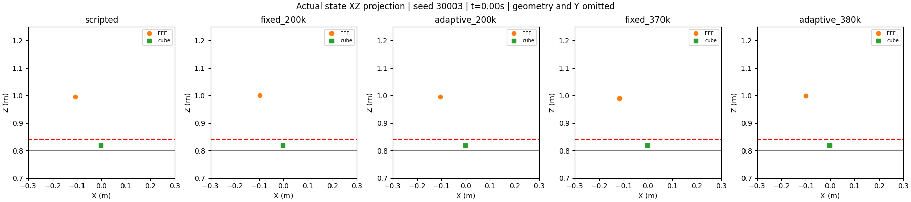
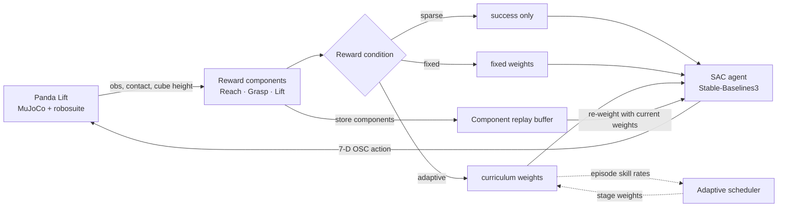
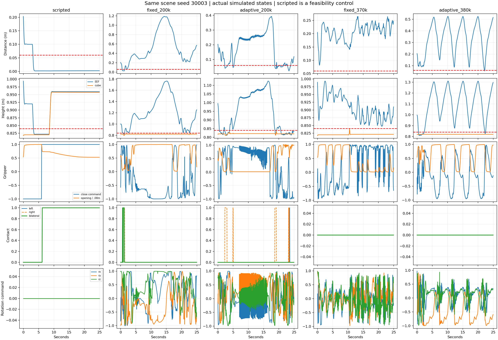

<div align="center">

# Adaptive Reward Shaping for Robotic Grasping

**Curriculum-weighted reward shaping with Soft Actor-Critic on a simulated Franka Panda arm**

*ME5418 Machine Learning in Robotics · Group 36*

[](https://www.python.org/)
[](https://mujoco.org/)
[](https://robosuite.ai/)
[](https://gymnasium.farama.org/)
[](https://stable-baselines3.readthedocs.io/)
[](https://pytorch.org/)
[](tests/)
[](#installation)

[English](README.md) · [简体中文](README.zh-CN.md)



<sub>Actual simulation positions projected onto the XZ plane. The scripted controller is a feasibility reference; the other panels are learned SAC policies in the same scene.</sub>

</div>

---

## Table of Contents

- [Overview](#overview)
- [Highlights](#highlights)
- [Method](#method)
  - [Task and Environment](#task-and-environment)
  - [Reward Design](#reward-design)
  - [Adaptive Curriculum](#adaptive-curriculum)
  - [Component Replay Buffer](#component-replay-buffer)
- [Results](#results)
- [Installation](#installation)
- [Quick Start](#quick-start)
- [Training and Evaluation](#training-and-evaluation)
- [Repository Structure](#repository-structure)
- [Testing](#testing)
- [Limitations and Future Work](#limitations-and-future-work)
- [Acknowledgements](#acknowledgements)
- [Citation](#citation)

---

## Overview

Long-horizon manipulation tasks such as **reach → grasp → lift** are hard to learn from sparse success signals, while hand-tuned dense rewards with fixed weights can over-reward early sub-skills and stall later ones. This project studies **adaptive reward shaping**: the relative weights of the Reach, Grasp, and Lift reward components change over training according to the agent's measured skill success, forming an automatic curriculum.

The agent is trained with **Soft Actor-Critic (SAC)** on the robosuite **Panda Lift** task in MuJoCo. Sparse, fixed-weight, and adaptive-weight conditions share the same robot, controller, observation and action spaces, network architecture, and success criterion, so the reward condition is the only experimental variable.

The repository has two parts:

| Part | Folder | Scope |
|---|---|---|
| **Research pipeline** | repository root | SAC training, adaptive curriculum, evaluation, failure diagnostics, and result plots |
| **Environment milestone** | [`GraspRL/`](GraspRL/README.md) | Original `AdaptiveGrasp-v0` Gymnasium environment, scheduler, tests, demos, and two-page report |

## Highlights

- 🦾 **Shared task setup**: one environment factory for sparse, fixed, and adaptive rewards, with an identical success criterion in every condition.
- 📈 **Episode-level curriculum**: sliding-window skill rates, periodic updates, and consecutive confirmations prevent noisy stage switches.
- 🔁 **Reward recomputation in replay**: per-step reward *components* are stored, so off-policy samples are re-weighted with the *current* curriculum weights.
- 🔬 **Behavioural diagnostics**: distance, bilateral contact, gripper timing, and lift traces classify each failure instead of reporting a single return.
- ✅ **Tested and reproducible**: pytest suites for rewards, scheduler, environment, replay buffer, and SB3 compatibility; pinned dependency lock.

## Method



### Task and Environment

| Item | Setting |
|---|---|
| Robot | Franka Panda, 7-DoF arm with parallel-jaw gripper |
| Scene | robosuite `Lift`: a randomly placed cube on a table |
| Controller | `OSC_POSE` operational-space control, 20 Hz |
| Action | 7-D continuous in `[-1, 1]`: Δposition (3), Δrotation (3), gripper (1) |
| Observation | Robot proprioception + object state (flat vector; optional contact-progress features) |
| Success | robosuite native check: cube centre higher than table + 0.04 m |
| Episode horizon | 500 control steps (configurable) |

### Reward Design

Each step produces three components in `[0, 1]`:

| Component | Definition |
|---|---|
| **Reach** | $r_{\text{reach}} = 1 - \tanh(10\,\lVert p_{\text{eef}} - p_{\text{cube}}\rVert)$ |
| **Grasp** | Bilateral finger contact with the cube; optionally ramped over `k` uninterrupted contact steps (`--grasp-hold-steps`) |
| **Lift** | Height progress toward the success height, **gated by a valid grasp** so collision bounces earn nothing |

All conditions use one reward scale:

$$
r_t =
\begin{cases}
1, & \text{if the task succeeds} \\
0.5 \cdot \mathbf{w}_t^\top \mathbf{c}_t, & \text{otherwise}
\end{cases}
\qquad \mathbf{c}_t = (r_{\text{reach}}, r_{\text{grasp}}, r_{\text{lift}}),\ \ \lVert \mathbf{w}_t \rVert_1 = 1
$$

so unsuccessful shaped rewards stay in `[0, 0.5]` and every success is worth exactly `1`, matching the sparse condition.

### Adaptive Curriculum

| Stage | Weights (Reach / Grasp / Lift) | Advance when |
|---|---|---|
| 1 · Reach | 0.77 / 0.15 / 0.08 | Reach rate ≥ 0.7 |
| 2 · Grasp | 0.19 / 0.63 / 0.19 | Reach rate ≥ 0.7 **and** Grasp rate ≥ 0.7 |
| 3 · Lift | 0.07 / 0.21 / 0.71 | final stage |
| *Fixed baseline* | 0.13 / 0.43 / 0.43 | — |

- Skill rates use a sliding window of the last **100** completed episodes and are checked every **10** episodes after warm-up.
- A stage switch requires **2 consecutive** successful checks; weights stay constant within an episode.
- Optional linear interpolation between stages (`--transition-episodes`) smooths the change in the reward landscape.

### Component Replay Buffer

Because the adaptive reward is non-stationary, storing scalar rewards would mix rewards from different curriculum stages. `training/replay_buffer.py` stores the three components per transition and recomputes the reward at sampling time using the current weights, preserving time-limit bootstrap semantics. The `--historical-rewards` flag keeps the stored scalar rewards as an ablation.

## Results

> **Note**: these are preliminary single-seed results with small evaluation samples. They test the pipeline and expose failure modes; they do **not** establish that adaptive shaping outperforms fixed shaping.

**Fixed vs. adaptive SAC** (20 held-out evaluation episodes per checkpoint, [raw CSV](results/original_evaluation.csv))

| Condition | Checkpoint | Steps | Reach | Grasp | Lift success | Stable lift |
|---|---|---:|---:|---:|---:|---:|
| Fixed | before | 100k | 0.80 | 0.10 | 0.00 | 0.00 |
| Fixed | after | 200k | 0.65 | 0.40 | 0.00 | 0.00 |
| Fixed | best | 130k | 0.30 | 0.05 | 0.00 | 0.00 |
| Adaptive | before | 100k | **1.00** | 0.35 | **0.10** | **0.05** |
| Adaptive | after | 200k | 0.90 | 0.25 | 0.05 | 0.05 |
| Adaptive | best | 150k | 0.80 | **0.40** | 0.00 | 0.00 |

**Failure diagnostics** (three held-out scenes per policy, [raw CSV](results/failure_diagnostics.csv))

| Policy | Outcomes over 3 scenes | Min. distance to cube |
|---|---|---|
| Scripted reference | 3 × held lift | ≈ 2 mm |
| Fixed 200k | 1 × contact without held lift, 2 × never reached | 26–79 mm |
| Adaptive 200k | 2 × near without bilateral contact, 1 × contact without held lift | 22–48 mm |
| Fixed 370k | 3 × never reached | 76–104 mm |
| Adaptive 380k | 1 × near without bilateral contact, 2 × never reached | 55–155 mm |

<p align="center">
  
  <br><sub>Distance, cube height, gripper opening, and contact traces for the same scene.</sub>
</p>

**Key observations**

1. The task is physically feasible: the scripted controller reaches, grasps bilaterally, and lifts in every diagnostic scene.
2. Learned policies mostly fail **before** a stable grasp: they either do not approach closely enough or close the gripper without bilateral contact.
3. Longer training (370k–380k steps) did not fix these failures; reaching degraded in several scenes.
4. A preparation-reward pilot (`--reward-profile prepare_v1`, 10k steps) produced no grasps or lifts in ten held-out scenes ([raw CSV](results/preparation_pilot.csv)).

## Installation

Validated on **Windows 11 x64, CPU only**. Linux and macOS have not been tested.

```bash
git clone https://github.com/Joel-tao/Deep-agent-learning.git
cd Deep-agent-learning
conda env create -f environment.yml
conda activate learning_agent_g36
python -c "import mujoco, robosuite, gymnasium, stable_baselines3; print('OK')"
```

`requirements-lock.txt` pins every package. Do **not** upgrade MuJoCo on its own: newer releases changed the `MjData.qM` interface used by the OSC controller in robosuite 1.5.2.

## Quick Start

```bash
# Scripted grasp demo: runs a real MuJoCo episode and saves an animation + trajectory
python demo.py

# Open the native MuJoCo viewer as well (needs a display / OpenGL)
python demo.py --viewer

# Random policy, or a trained model
python demo.py --policy random
python demo.py --policy model --model runs/adaptive_example/adaptive/seed_42/policy.zip
```

Output is written to `demo_output/` by default.

## Training and Evaluation

```bash
# Short runs that exercise the full pipeline
python -m training.train_fixed    --seed 42 --timesteps 10000 --output-root runs/fixed_example
python -m training.train_adaptive --seed 42 --timesteps 10000 --output-root runs/adaptive_example
python -m training.train_sparse   --seed 42 --timesteps 10000 --output-root runs/sparse_example

# Evaluate a policy with the shared sparse success criterion
python -m evaluation.evaluate runs/adaptive_example/adaptive/seed_42/policy.zip --episodes 20 --seed 30000
```

<details>
<summary><b>Useful training options</b></summary>

| Option | Default | Purpose |
|---|---|---|
| `--timesteps` | 1,000,000 | Environment interaction budget |
| `--horizon` | 500 | Control steps per episode |
| `--buffer-size` | 500,000 | Replay capacity |
| `--normalize-observations` | off | Standardize policy inputs; statistics are saved with the model |
| `--grasp-hold-steps` | 1 | Contact-reward ramp length; use `5` for the sustained-contact experiment |
| `--reward-profile` | `legacy` | `prepare_v1` adds the optional pre-grasp preparation reward |
| `--scheduler-window` / `--scheduler-interval` | 100 / 10 | Curriculum window and update interval |
| `--scheduler-confirmations` | 2 | Consecutive checks required to advance |
| `--transition-episodes` | 0 | Episodes over which stage weights are interpolated |
| `--historical-rewards` | off | Ablation: replay stored scalar rewards instead of recomputing |
| `--resume` | — | Continue from a checkpoint into a new output root |

Each run saves its full configuration next to the model.
</details>

Analysis scripts in `evaluation/` reproduce the tables and figures: `diagnose.py`, `analyze_failures.py`, `plot_results.py`, `plot_policy_validation.py`, `compare_preparation.py`, and `pilot_summary.py`.

## Repository Structure

```text
Deep-agent-learning/
├── demo.py                       # Scripted / random / trained-policy demo
├── envs/                         # Simulator wrappers
│   ├── lift_env.py               #   robosuite Panda Lift -> Gymnasium
│   ├── factory.py                #   one factory for sparse / fixed / adaptive
│   ├── task_info_wrapper.py      #   shared success and skill metrics
│   ├── contact_observation.py    #   optional contact-progress features
│   ├── observation_normalization.py
│   └── skill_diagnostics.py
├── rewards/                      # Reward components and curriculum
│   ├── components.py             #   Reach / Grasp / Lift terms
│   ├── scaling.py                #   shared reward scale and weight normalisation
│   ├── adaptive_reward.py        #   episode-level curriculum scheduler
│   ├── adaptive_reward_wrapper.py
│   └── preparation.py            #   optional pre-grasp reward
├── training/                     # SAC training
│   ├── train.py                  #   shared runner
│   ├── train_sparse.py | train_fixed.py | train_adaptive.py
│   ├── replay_buffer.py          #   component replay buffer
│   └── callbacks.py              #   lift metrics and success-rate evaluation
├── evaluation/                   # Evaluation, diagnostics and plotting
├── tests/                        # pytest suites
├── results/                      # Evaluation and diagnostic CSVs
├── media/                        # README figures
├── GraspRL/                      # Environment milestone (AdaptiveGrasp-v0)
├── environment.yml
└── requirements-lock.txt
```

## Testing

```bash
python -m pytest -q
```

The suites cover reward components and scaling, scheduler warm-up / confirmation / staging, replay-buffer reward recomputation and time-limit handling, observation normalisation, environment seeding and spaces, MuJoCo physics checks, and Stable-Baselines3 environment compatibility.

## Limitations and Future Work

- **Evidence is preliminary**: single training seed and 20-episode evaluations. A fair comparison needs equal budgets, multiple seeds, and confidence intervals on success rate rather than raw return.
- **Grasp is a contact proxy**: bilateral contact does not prove force closure or long-term stability.
- **Non-stationary reward**: curriculum weights are not part of the observation, so the effective reward changes during training even with replay recomputation.
- **No vision or sim-to-real**: observations are low-dimensional state only.

Possible next steps: multi-seed experiments, success-rate–driven regression between stages, weight-conditioned critics, image observations, and domain randomisation.

## Acknowledgements

- [MuJoCo](https://mujoco.org/) for physics simulation
- [robosuite](https://robosuite.ai/) for the Panda robot model, OSC controller, and Lift scene
- [Gymnasium](https://gymnasium.farama.org/) for the environment interface
- [Stable-Baselines3](https://stable-baselines3.readthedocs.io/) and [PyTorch](https://pytorch.org/) for SAC

Developed for ME5418 at the National University of Singapore. Parts of the code and documentation were written with AI assistance and verified locally, as disclosed in the course submission.

## Citation

```bibtex
@misc{me5418g36_adaptive_grasp,
  title        = {Adaptive Reward Shaping for Robotic Grasping},
  author       = {{ME5418 Group 36}},
  year         = {2026},
  howpublished = {\url{https://github.com/Joel-tao/Deep-agent-learning}}
}
```
