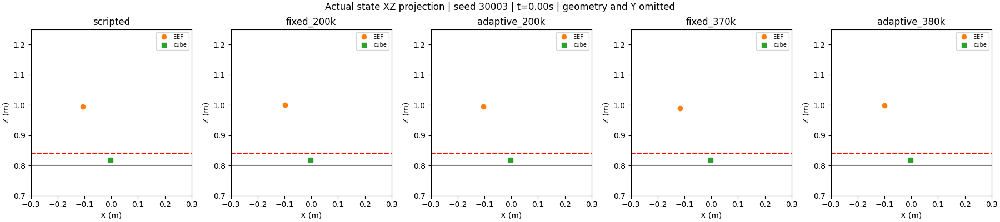

<div align="center">

# 面向机器人抓取的自适应奖励塑形

**基于 Soft Actor-Critic 与课程式奖励权重的 Franka Panda 仿真抓取**

*ME5418 Machine Learning in Robotics · Group 36*

[English](README.md) · [简体中文](README.zh-CN.md)



</div>

---

## 项目简介

“接近 → 抓取 → 抬起”这类长时序操作任务很难仅靠稀疏的成功信号学习；而固定权重的稠密奖励又容易过度奖励前期子技能、导致后期技能停滞。本项目研究**自适应奖励塑形**：根据智能体在最近若干 Episode 中的技能成功率，自动调整 Reach、Grasp、Lift 三个奖励分量的权重，形成自动课程。

智能体使用 **SAC** 在 MuJoCo + robosuite 的 **Panda Lift** 任务上训练。Sparse、Fixed、Adaptive 三种条件共享机器人、控制器、观测/动作空间、网络结构与成功判据，奖励条件是唯一的实验变量。

| 部分 | 目录 | 内容 |
|---|---|---|
| **研究流水线** | 仓库根目录 | SAC 训练、自适应课程、评估、失败诊断与绘图 |
| **环境里程碑** | [`GraspRL/`](GraspRL/README.md) | 自定义 `AdaptiveGrasp-v0` Gymnasium 环境、调度器、测试、演示与报告 |

## 核心特点

- 🦾 **统一任务设置**：一个环境工厂生成三种奖励条件，成功判据完全一致。
- 📈 **Episode 级课程调度**：滑动窗口成功率 + 周期更新 + 连续确认，避免噪声导致的阶段抖动。
- 🔁 **Replay 奖励重算**：回放池保存每步奖励分量，采样时按当前课程权重重新计算奖励。
- 🔬 **行为诊断**：通过距离、双侧接触、夹爪时机和抬升轨迹对失败进行分类，而不只看回报。
- ✅ **可测试、可复现**：pytest 覆盖奖励、调度器、环境、回放池与 SB3 兼容性；依赖版本完全锁定。

## 方法

**奖励分量**（均在 `[0, 1]`）：

- **Reach**：$1 - \tanh(10\,\lVert p_{\text{eef}} - p_{\text{cube}}\rVert)$
- **Grasp**：左右指与方块的双侧接触；可选按连续接触步数渐增（`--grasp-hold-steps`）
- **Lift**：向成功高度的抬升进度，**仅在有效抓取时计入**

**统一奖励尺度**：成功时奖励为 1；否则为 $0.5 \cdot \mathbf{w}_t^\top \mathbf{c}_t$，权重和为 1。

**课程阶段**：

| 阶段 | 权重 (Reach / Grasp / Lift) | 晋级条件 |
|---|---|---|
| 1 · Reach | 0.77 / 0.15 / 0.08 | Reach 成功率 ≥ 0.7 |
| 2 · Grasp | 0.19 / 0.63 / 0.19 | Reach ≥ 0.7 且 Grasp ≥ 0.7 |
| 3 · Lift | 0.07 / 0.21 / 0.71 | 最终阶段 |
| *Fixed 基线* | 0.13 / 0.43 / 0.43 | — |

滑动窗口为最近 100 个完成的 Episode，预热后每 10 个 Episode 检查一次，需连续 2 次满足才切换阶段。

## 实验结果

> 以下为单随机种子、小样本的初步结果，用于验证流程并暴露失败模式，**并不能**证明 Adaptive 优于 Fixed。

| 条件 | Checkpoint | 步数 | Reach | Grasp | Lift 成功 | 稳定抬起 |
|---|---|---:|---:|---:|---:|---:|
| Fixed | before | 100k | 0.80 | 0.10 | 0.00 | 0.00 |
| Fixed | after | 200k | 0.65 | 0.40 | 0.00 | 0.00 |
| Adaptive | before | 100k | **1.00** | 0.35 | **0.10** | **0.05** |
| Adaptive | after | 200k | 0.90 | 0.25 | 0.05 | 0.05 |

主要结论：脚本控制器在所有诊断场景中都能完成抓取抬起，说明任务物理上可行；学习到的策略主要失败在稳定抓取**之前**——没有足够接近方块，或在没有双侧接触时就闭合夹爪。完整数据见 [`results/`](results/)，详细分析见[英文 README](README.md#results)。

## 安装与运行

已在 **Windows 11 x64（仅 CPU）** 上验证。

```bash
git clone https://github.com/Joel-tao/Deep-agent-learning.git
cd Deep-agent-learning
conda env create -f environment.yml
conda activate learning_agent_g36

python demo.py                 # 脚本抓取演示，保存动画与轨迹
python -m pytest -q            # 运行测试

python -m training.train_adaptive --seed 42 --timesteps 10000 --output-root runs/adaptive_example
python -m evaluation.evaluate runs/adaptive_example/adaptive/seed_42/policy.zip --episodes 20 --seed 30000
```

请勿单独升级 MuJoCo：新版本的 `MjData.qM` 接口变化会导致 robosuite 1.5.2 的 OSC 控制器无法启动。

## 局限性

- 单种子、20 集评估，证据有限；公平比较需要相同预算、多随机种子和成功率置信区间。
- 抓取判据为双侧接触代理指标，不等于力闭合或长期稳定性。
- 课程权重未加入观测，奖励在训练中是非平稳的。
- 仅使用低维状态观测，未涉及视觉与真实机器人迁移。

## 致谢

感谢 MuJoCo、robosuite、Gymnasium、Stable-Baselines3 与 PyTorch 等开源项目。本项目为新加坡国立大学 ME5418 课程作业，部分代码与文档在 AI 辅助下完成并经本地验证。
